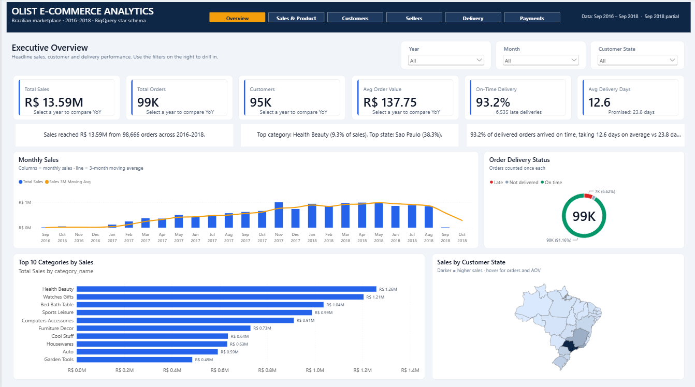
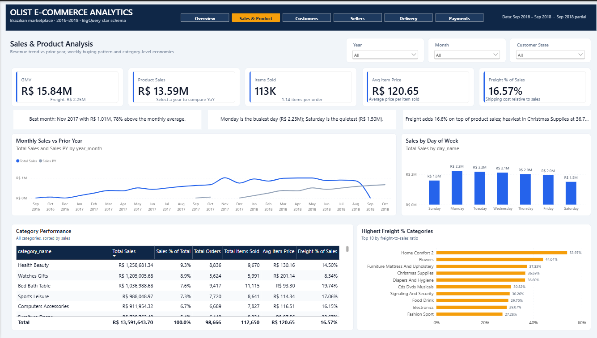
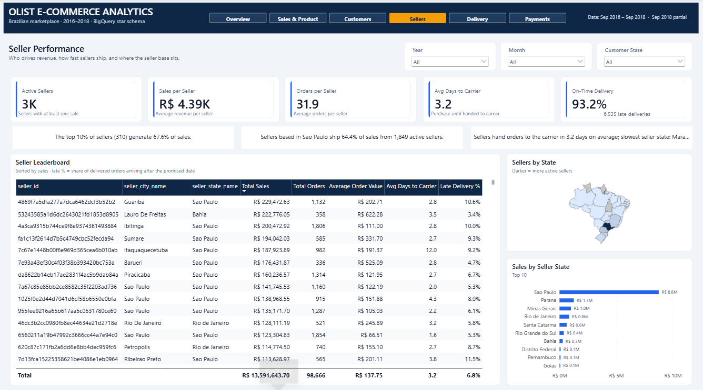
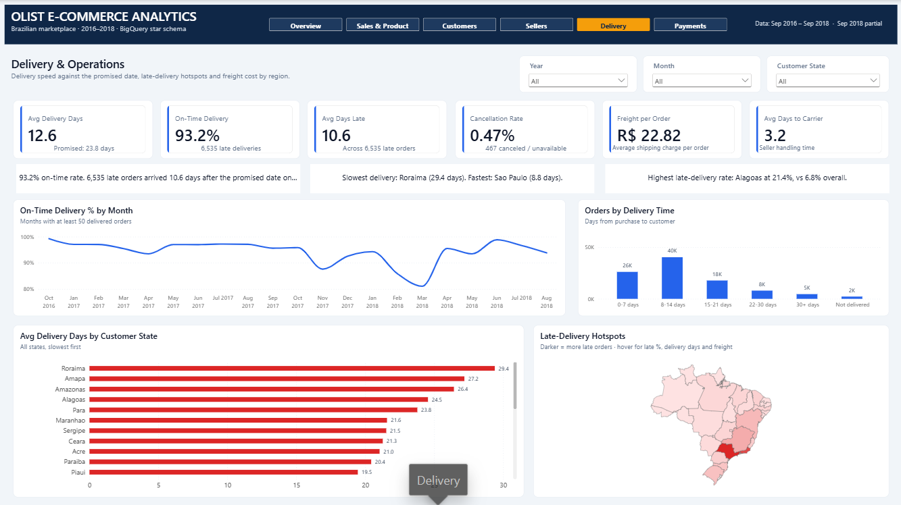
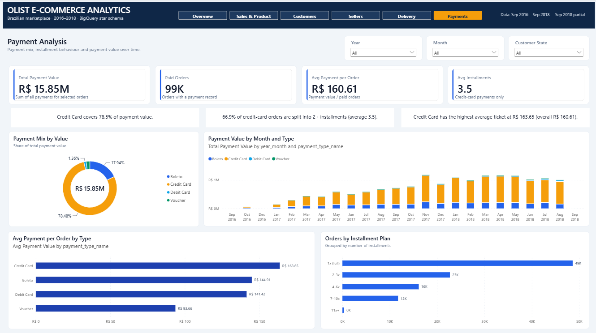

# Olist E-Commerce Analytics Dashboard (Power BI)

A six-page Power BI report on the [Olist Brazilian E-Commerce dataset](https://www.kaggle.com/datasets/olistbr/brazilian-ecommerce) (~100K orders, 2016–2018). The data is modelled as a star schema in **Google BigQuery** and analysed in a **Power BI semantic model** with 80+ DAX measures. The report is saved in the Power BI Project (PBIP) format, so the model (TMDL) and every report page (PBIR JSON) are plain text and version-controlled.



## What the report answers

| Page | Business questions |
|---|---|
| **Overview** | How are sales, orders, customers, AOV and delivery performance trending? Which categories and states drive revenue? |
| **Sales & Product** | How does each month compare with the prior year? Which weekdays sell most? What are the economics of each category, including freight cost? |
| **Customers** | How many customers are new vs returning? Where are they, and where do they spend the most? |
| **Sellers** | How concentrated is revenue among sellers? How fast do sellers hand orders to carriers? |
| **Delivery** | What is the on-time rate vs the promised date? Where are the late-delivery hotspots? |
| **Payments** | What is the payment mix? How do customers use credit-card installments? |

Each page has:
- **KPI cards** with prior-year comparison (green ▲ / red ▼ when a single year is selected).
- **Dynamic insight cards**: DAX-generated sentences that rewrite themselves when the filters change, e.g. *"Sao Paulo holds __% of customers; the top 3 states hold __%."*, where the numbers follow the current selection
- **Synced filters** for year, month and customer state.
- **Shape maps** of Brazilian states, on the location-based pages.

## Data model

Star schema built in BigQuery (`olist_analytics` dataset) and imported into Power BI:

```
                 dim_date
                    │
dim_customers ── fact_order_items ── dim_products
                    │
                dim_sellers

fact_order_payments  (linked to orders through TREATAS on order_id)
```

## DAX highlights

Measures are grouped in display folders: Sales, Time Intelligence, Customers, Operations, Sellers, Payments, Insights, Labels.

- **Time intelligence**: YoY / MoM %, YTD, 3-month moving average, prior-year comparisons.
- **Customer analytics**: new vs returning customers (based on first order date), repeat-customer rate.
- **Delivery**: on-time %, average days late, a delivery-speed band, and a trend measure that hides months with fewer than 50 delivered orders.
- **Payments**: a disconnected payments fact filtered with `TREATAS`, plus installment-plan bands.
- **Narrative insights**: `TOPN` + `CALCULATE` patterns that find the leading category, state, month or seller segment and print its share. They include minimum-volume thresholds so tiny segments don't "win".
- **Readable labels**: calculated columns that turn state codes into full state names, Title Case city names, and turn `health_beauty` into `Health Beauty`.

Example – top-10% seller concentration:

```DAX
Insight Sellers 1 =
VAR n = ROUNDUP ( [Total Sellers] * 0.1, 0 )
VAR topSellers = TOPN ( n, VALUES ( dim_sellers[seller_id] ), [Total Sales] )
RETURN
    IF ( ISBLANK ( [Total Sales] ), "No data for the current selection.",
        "The top 10% of sellers (" & FORMAT ( n, "#,0" ) & ") generate "
            & FORMAT ( DIVIDE ( CALCULATE ( [Total Sales], topSellers ), [Total Sales] ), "0.0%" )
            & " of sales." )
```

## Screenshots

| | |
|---|---|
|  |  |
|  |  |
|  | |

## Repository structure

```
Olist_Ecommerce_Dashboard.pbip              # open this in Power BI Desktop
Olist_Ecommerce_Dashboard.SemanticModel/    # model as TMDL: tables, measures, relationships
Olist_Ecommerce_Dashboard.Report/           # report pages and visuals as PBIR JSON + custom theme
images/                                     # report screenshots
```

## How to open

1. Install [Power BI Desktop](https://powerbi.microsoft.com/desktop/), October 2026 or later.
2. Open `Olist_Ecommerce_Dashboard.pbip`.
3. The data cache is not committed. Refreshing needs access to a BigQuery project that holds the Olist star schema. To use your own project, change the source in Power Query.
4. Shape maps: enable **Options → Preview features → Shape map visual**, then set **Map type → Brazil: States** on each map.

## Tools

Google BigQuery · Power BI Desktop (PBIP / TMDL / PBIR) · DAX · Power Query (M)

---
Built by **Agung Budi Wirawan** · [LinkedIn](https://linkedin.com/in/agungbudiwirawan) · [GitHub](https://github.com/agungbudiwirawan)
