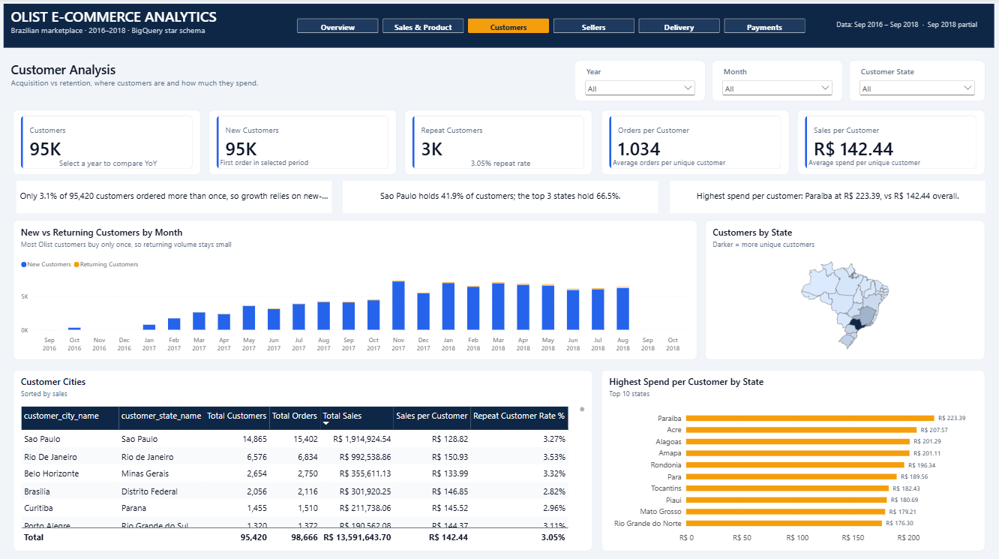

# Olist E-Commerce Dashboard

Power BI dashboard for the [Olist Brazilian E-Commerce dataset](https://www.kaggle.com/datasets/olistbr/brazilian-ecommerce) (around 100K orders, 2016–2018). The data comes from a star schema I built in Google BigQuery.

Full demo video: [images/demo.mp4](images/demo.mp4)

## Pages

- **Overview**: sales, orders, customers, AOV and on-time delivery, compared with the previous year
- **Sales & Product**: monthly sales vs the previous year, sales by weekday, category performance
- **Customers**: new vs returning customers, customers by state, top cities
- **Sellers**: seller leaderboard, seller locations, time to hand orders to the carrier
- **Delivery**: on-time rate, delivery time, late deliveries by state
- **Payments**: payment mix, installments, payment value over time

Each page has filters for year, month and state. Below the KPIs, short text insights update with the filters.

## Data model

- Fact tables: `fact_order_items`, `fact_order_payments`
- Dimension tables: `dim_customers`, `dim_products`, `dim_sellers`, `dim_date`

The DAX covers time intelligence (YoY, MoM, YTD, moving average), customer retention, delivery performance, and the text insights.

## Screenshots

| | |
|---|---|
|  |  |
|  |  |
|  |  |

## How to open

The project is saved as a Power BI Project (`.pbip`). Open `Olist_Ecommerce_Dashboard.pbip` in Power BI Desktop. The data cache is not included, so refreshing needs access to the BigQuery dataset.

## Tools

Google BigQuery, Power BI, DAX, Power Query
